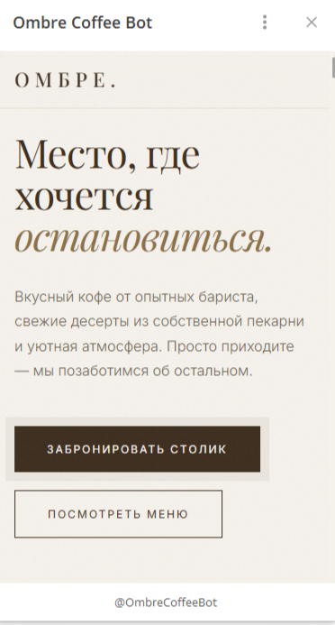

# ☕ Кофейня Омбре — Уютное место в Хорошево-Мневниках

Современный лендинг для кофейни с интеграцией Telegram-бота и Mini App. Заявки на бронирование столика мгновенно приходят в Telegram владельца через безопасный Cloudflare Worker.

**Live Demo:** [https://alphastatex.github.io/ombre-coffee/](https://alphastatex.github.io/ombre-coffee/)

---

## 📱 Telegram Mini App

Сайт работает как **нативное приложение внутри Telegram**:

- 📱 Открывается по кнопке в боте (без перехода в браузер)
- **Имя пользователя подставляется автоматически** из Telegram-профиля
- 🟤 Нативная кнопка **MainButton** внизу экрана Telegram
- ⚡ Мгновенная загрузка (SDK инжектится самим Telegram)

### Как это работает:

1. Пользователь открывает бота и нажимает "Открыть кофейню"
2. Telegram открывает сайт в своём встроенном браузере
3. SDK Telegram автоматически подставляется в страницу
4. Код в `app.js` определяет среду через `window.Telegram.WebApp`
5. Имя берётся из `tg.initDataUnsafe.user.first_name`
6. Главная кнопка Telegram привязана к отправке формы

---

## 🛠 Стек технологий

| Категория    | Технологии                                   |
| ------------ | -------------------------------------------- |
| **Frontend** | HTML5, CSS3, Vanilla JavaScript              |
| **Деплой**   | GitHub Pages                                 |
| **Бэкенд**   | Cloudflare Workers (прокси для Telegram API) |
| **API**      | Telegram Bot API + Telegram Web App SDK      |

---

## Ключевые фичи

### Дизайн и анимации

- **Элегантный минимализм** — тёплые кофейные тона, шрифты Playfair Display + Inter
- **Кастомный курсор** — точка + кольцо с плавным следованием
- **Scroll-reveal анимации** — элементы появляются при скролле
- **Parallax-эффекты** — глубина на hero-секции
- **Счётчики** — анимированный подсчёт статистики (4 года, 2500 чашек, 98% довольных)
- **Магнитные кнопки** — притягиваются к курсору
- **Grain-эффект** — текстура плёнки поверх всего сайта
- **Preloader** — анимированная загрузка с появлением логотипа

## 📸 Скриншоты

| Hero-секция            | Меню                   | Форма бронирования           |
| ---------------------- | ---------------------- | ---------------------------- |
|  |  |  |

### 📋 Функционал

- **Форма бронирования** с:
    - Маской телефона `+7 (XXX) XXX-XX-XX`
    - Валидацией всех полей
    - Выбором даты, времени и количества гостей
- **Telegram-уведомления** — заявка приходит мгновенно в формате HTML
- **Lightbox-галерея** — просмотр фото атмосферы кофейни
- **Карусель отзывов** — автоплей, навигация точками и стрелками
- **Smooth scroll** — плавная прокрутка к секциям
- **Scroll progress bar** — индикатор прокрутки страницы
- **Кнопка "Наверх"** — появляется при скролле

### 🔒 Безопасность

- **Токен бота не виден в коде** — он живёт в Cloudflare Worker
- **CORS настроен** — воркер принимает запросы только с нужных доменов
- **Валидация на клиенте** — защита от некорректных данных

---

## 🚀 Быстрый старт

```bash
# Клонировать репозиторий
git clone https://github.com/alphastatex/ombre-coffee.git
cd ombre-coffee

# Запустить локально
npx serve .

# Открыть в браузере
# http://localhost:3000

ombre-coffee/
├── index.html              # Разметка
├── styles.css              # Стили + анимации
├── app.js                  # Основная логика + Telegram Mini App
├── utils.js                # Утилиты (маска телефона)
├── images/                 # Фотографии кофейни
├── package.json            # Зависимости (serve, vitest, playwright)
└── README.md               # Этот файл

MIT © 2026 alphastatex
```
