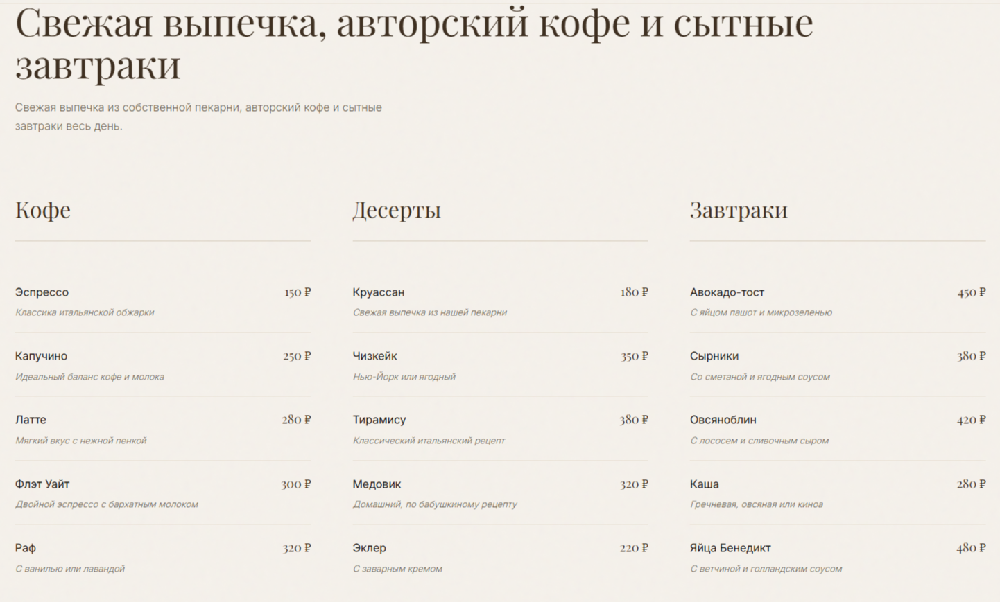
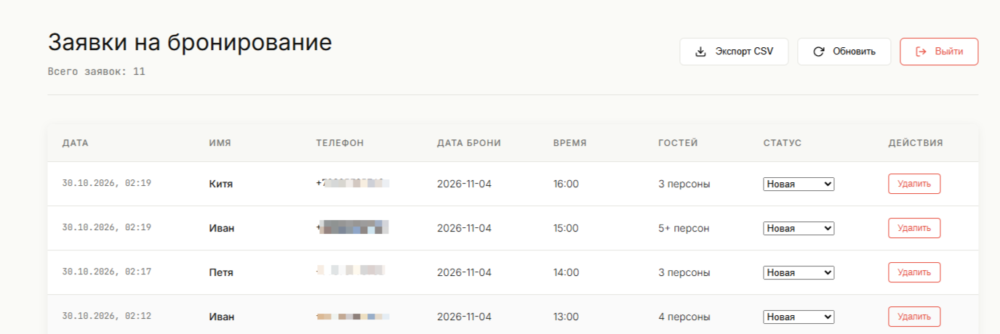

# ☕ Омбре (Ombre Coffee) — Сайт и система бронирования

> Уютный лендинг кофейни с Telegram Mini App, защищенным бэкендом на Cloudflare Workers и собственной CRM-админкой для управления заявками.

**Live Demo:** https://alphastatex.github.io/ombre-coffee/  
**Админ-панель:** https://alphastatex.github.io/ombre-coffee/admin.html

---

## 📸 Скриншоты

|          Главный экран          |    Меню и атмосфера    |
| :-----------------------------: | :--------------------: |
|  |  |

|    CRM-админка (Заявки)    |      Mini App в Telegram       |
| :------------------------: | :----------------------------: |
|  |  |

---

## 🏗 Архитектура и Безопасность

Проект использует гибридную архитектуру для обхода блокировок и защиты данных клиентов.

### 🛡️ Zero Trust (Нулевое доверие)

Ранее проект использовал открытый прокси и хранил пароль в коде. Теперь архитектура полностью безопасна:

1. **Валидация `initData`:** Cloudflare Worker проверяет криптографическую подпись (HMAC-SHA256) от Telegram. Заявки из браузера проходят с пометкой, а поддельные данные блокируются.
2. **Секреты Cloudflare:** Токен бота, ID чата и пароль от админки хранятся в зашифрованных секретах (`wrangler secret`), а не в коде.
3. **XSS-защита:** Все входящие данные (имя, комментарий) экранируются на сервере перед отправкой в Telegram.
4. **Асинхронная отправка:** Благодаря `ctx.waitUntil()` форма отвечает клиенту моментально, а сообщение в Telegram улетает в фоне (защита от таймаутов).

### 🗄️ База данных

Используется **Cloudflare KV** для хранения заявок и их статусов (`Новая`, `В работе`, `Обработано`).

---

## ✨ Функционал

### Для клиентов (Сайт + Mini App)

- Бронирование столика (выбор даты, времени, количества гостей).
- Автоматическая маска для телефона.
- Валидация полей перед отправкой.
- **Telegram Mini App:** Автоподстановка имени, нативная кнопка `MainButton`, адаптация под тему пользователя.
- **Обход блокировок:** Локальная копия Telegram SDK (не зависит от заблокированного `telegram.org`).

### Для администратора (CRM-панель)

- Защищенный вход по паролю (через `Authorization: Bearer`).
- Удобная таблица заявок с сортировкой от новых к старым.
- Смена статуса заявки в один клик.
- Удаление заявок.
- **Экспорт в CSV** (с BOM для корректного открытия в Excel).

---

## 🛠 Стек технологий

| Категория     | Технологии                                  |
| :------------ | :------------------------------------------ |
| **Frontend**  | HTML5, CSS3, Vanilla JavaScript (ES-модули) |
| **Типизация** | TypeScript через JSDoc (`@ts-check`)        |
| **Бэкенд**    | Cloudflare Workers, Cloudflare KV           |
| **Тесты**     | Vitest (юнит) + Playwright (E2E)            |
| **Линтинг**   | Biome                                       |
| **Деплой**    | GitHub Pages (статика), Wrangler (воркер)   |

---

## 📂 Структура проекта

```text
ombre-coffee/
├── index.html              # Разметка сайта
├── admin.html              # CRM-админка (деплоится на GitHub Pages)
├── main.js                 # Логика фронтенда (бывший app.js)
├── telegram-web-app.js     # Локальная копия SDK Telegram (обход блокировок)
├── styles.css              # Стили
├── utils.js                # Чистые функции (маска телефона)
├── tests/
│   └── smoke.spec.js       # E2E-тесты Playwright
├── docs/                   # Скриншоты для README
└── tg-ombre-proxy/         # Бэкенд (Cloudflare Worker)
    ├── src/index.js        # Безопасный код воркера (API + Telegram)
    ├── admin.html          # (Исходная версия админки, теперь в корне)
    ├── .gitignore          # Игнорируем node_modules
    └── wrangler.toml       # Конфиг (KV биндинг)
```

---

## 🚀 Быстрый старт (Локально)

### 1. Фронтенд

```bash
# Клонировать репозиторий
git clone https://github.com/alphastatex/ombre-coffee.git
cd ombre-coffee

# Установить зависимости
npm install

# Запустить локально
npx serve .
```

### 2. Бэкенд (Cloudflare Worker)

```bash
cd tg-ombre-proxy

# Авторизация в Cloudflare
npx wrangler login

# Добавление секретов
npx wrangler secret put BOT_TOKEN
npx wrangler secret put CHAT_ID
npx wrangler secret put ADMIN_PASSWORD

# Деплой воркера
npx wrangler deploy
```

---

MIT © 2026 alphastatex
